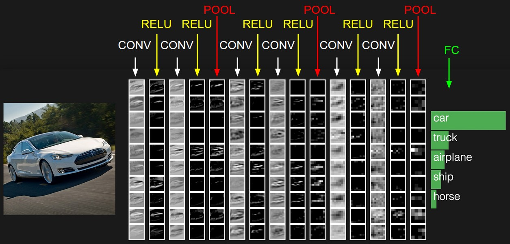

# brainTumourNN
Development of a colvolutional neural network capable of the classification (detection) of brain tumours from medical images

30/09/26
The first step of this project is going to be picking an appropriate dataset. I will be choosing a classification dataset meaning that I am not concerned by the location of the brain tumour (a segmentation problem) but instead, I am purely interested in whether there is a brain tumour or not, and the type of tumour if it exists. 

The first dataset that I have looked at is https://www.kaggle.com/datasets/masoudnickparvar/brain-tumor-mri-dataset, however, it contains a mix of different anatomical planes which might result in bias from the network. Also, the data has the large majority of the no tumour dataset in the axial view, whereas the other sets, like the meningioma folder in the testing set, contains largely sagittal plane images. The readme section of this conveniently contains a python script that is used in the preprocessing of the data to crop the images so they are all the same, which I will be using since this will save me a lot of time 
 
 Transformation of Data
 - Pixel intensities have been shifted from ranging from [0,1] now to [-1,1]
 - This has been done to help the optimisation step later on. It may give better accuracy in the weight update steps since we are centered around zero.

For reference when programming: 

Training Folder has 5600 images which is split up between 4 classes giving 1400 images in each class
- the training folder is made of 2 subfolders which are the vaidation and training subsets of 1120 and 4480 images per subset respectively 

Resources I have used to help me in the development of this Project: 

https://docs.pytorch.org/tutorials/beginner/basics/data_tutorial.html
https://docs.pytorch.org/vision/main/generated/torchvision.datasets.ImageFolder.html
https://github.com/mpirrall/pytorch-neural-network-tutorial-using-MNIST
https://www.geeksforgeeks.org/python/python-dictionary-comprehension/
https://pillow.readthedocs.io/en/stable/reference/Image.html
https://docs.pytorch.org/docs/2.15/data.html
https://literaryno4.github.io/cs231n-assignments-note5-Convolutional-neural-network.html/
https://vinesmsuic.github.io/cnn2/
My own neural network projects done previous to this 

An image from https://literaryno4.github.io/cs231n-assignments-note5-Convolutional-neural-network.html/ outlining a suitable architecture for this sort of problem that I will adapt. This documentation talks about the FC layer containing ten different scores each relating to a different class but obviously for this application I will only have 4 different classes, being that we have four unique classes for the network to guess from, that is, glioma, meningioma, notumour and pituitary

